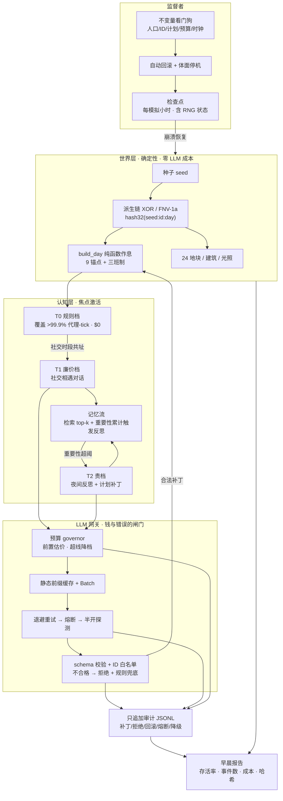

# 02 · 参考架构：千人通宵小镇怎么拼

> 结论先行：把系统切成 **世界层（确定性、零 LLM）／认知层（焦点激活、三档）／LLM 网关（钱与错误的闸门）／监督者（不变量与恢复）／审计与报告** 五块。每一块都有已验证的先例对应，不是发明。demo `demos/overnight_town.py` 是本架构的最小可运行实现。

## §1 总览图



## §2 组件 → 证据 → demo 映射

| 组件 | 职责 | 先例证据 | demo 实现 |
| --- | --- | --- | --- |
| 世界层 | 种子派生一切静态/节律状态；纯函数 | 千人小镇 XOR/FNV 链 [S16]；PRD F-01/C-05 [S15] | `fnv1a` + `Rng(mulberry32)` + `build_day` |
| 认知分层 T0/T1/T2 | 规则兜底 / 廉价社交 / 贵反思 | OASIS 激活概率 [S06]；AgentSociety 2 Two-Tier [S08]；360 统计代理 [S16] | `step_tick` 的社交窗口 + 反思选择 |
| 记忆流 | 全记录→检索→反思合成 | Generative Agents 三件套 [S01]；AI Town 检索限额 [S03] | `residents[].memories` + `retrieve()`（recency+importance+relevance 简化打分）|
| LLM 网关 | 预算/缓存/重试/熔断/校验 | Anthropic 缓存与 Batch [S13][S14]；官方限流教训 [S02]；GM 校验 [S10] | `MockLLM` + `gateway` + `validate_patch` |
| 监督者 | 不变量体检、检查点、回滚 | PRD §7.5/F-06 [S15]；AgentSociety 2 无状态+重放 [S08] | `Supervisor` + `CheckpointStore` |
| 审计/报告 | 只追加、模拟时间戳、可重放 | PRD §7.4 [S15]；JSONL replay [S08]；replay URL [S02] | `audit` 列表 + `_run()` 报告 dict（落盘 out/morning_report.json） |

## §3 数据契约（与 PRD §7 对齐）

**记忆记录**（Generative Agents 记忆流的简化 [S01]）：
```json
{"day": 1, "minute": 730, "text": "nurse-003 和 cook-012 在 plaza 聊了天气",
 "importance": 6.2, "kind": "conversation", "keywords": ["plaza", "天气", "nurse"]}
```

**计划补丁**（T2 反思产出，对象级、过校验才落库 [S15]）：
```json
{"target": "nurse-003", "scope": "behavior",
 "patch": {"tomorrow_focus": "health"}, "day": 2}
```
校验规则：`target` 必须在花名册白名单；`tomorrow_focus ∈ {work, family, health, social, study, null}`；越界即拒绝并审计 `patch_rejected`（军规 7）。

**审计条目**（只追加，模拟时间戳 [S15]）：
```json
{"day": 2, "minute": 1320, "type": "patch_rejected",
 "target": "cook-012", "reason": "focus 不在白名单", "raw": "征服世界"}
```

**检查点**（必须含 RNG 状态、记忆访问时钟与干预计数，否则续跑分叉——军规 5；GA PR #211 是真实反例 [S22]）：
```json
{"schema_version": 2, "tick": 132, "world": {"...全量居民/记忆/计划/事件/审计..."},
 "rng": {"llm": 987654321, "event": 555555555},
 "llm": {"rng": 987654321, "batch": false, "p_rate": 0.02, "p_bad": 0.02, "p_invalid": 0.03,
         "calls": 210, "cost": 0.18, "tokens": {"T1": [150537, 19543], "T2": [74968, 17518]},
         "prefix_written": {"T1": true, "T2": true},
         "breaker_until": -1, "backoff_until": -1, "breaker_half_open": false,
         "consec_fail": 0},
 "counters": {"...事件计数..."},
 "meta": {"rollbacks": 0, "violations_detected": 0, "unresolved": []}}
```
`load()` 是**语义校验单点**（冷重启/热恢复/回滚三路径共用：已知消费字段的必需键+类型+夜班 id ASCII 数字且前缀与 role 一致+keywords 字符串元素+audit 内部 type+数值字段有限拒 NaN/inf，并经 `_finite` 安全版拒超 float 范围的有限大整数如 10**400——避免 `math.isfinite` 抛 OverflowError 裸 traceback，R12 NEW-1）并返回深拷贝——恢复体与快照零共享（v1 别名污染 BLOCKER 的教训，回归测试 `test_checkpoint_isolation`）。消费点另有运行时防御（retrieve/audit_summary/build_day）构成纵深，**两层用不同机制**（校验 ASCII 谓词 / build_day try-int，避免共享 flawed 谓词使纵深失效，R11 MAJOR-1）；**不声称穷尽任意篡改**——未知形态由看门狗不变量（I3/I4 显式查 `_finite`）与体面停机兜底，存档 allow_nan=False 为最终闸门；深嵌套合法 JSON 的 RecursionError 在 load() 解析处捕获转干净 ValueError（R13 NEW-R13-1）；深拷贝处另有一道 catch 为**冗余兜底**（CPython 3.13 下文件解析比编码多一层包装帧、解析捕获恒先触发，该 catch 不可达、变异存活，其他 Python 版本或可达），main except 的 RecursionError 亦属冗余——不声称双重独立守卫。旧版快照缺失计数键在 resume 时自动补齐（跨版本兼容）。

## §4 主循环（伪代码，与 demo 一致）

```text
for tick in 0 .. nights×144:
    minute = (tick×10) % 1440; day = tick // 144
    if minute == 0: 重建当日全员计划（纯函数，T0）
    if minute ∈ 社交窗口 且 minute%30==0:
        按共址分组 → 种子抽样 ≤K 对 → gateway(T1) → 状态判定/规则兜底 → 记忆/审计
    if minute == 1320（入睡锚点）:
        选重要性累计超阈的 top-M 焦点代理 → gateway(T2) → 反思 + 补丁 schema 校验
    每 tick: 先 Supervisor.check() 体检
        → 违例: 回滚到最近干净检查点（≤3 次，超限体面停机）+ 回滚后立即存档（干预审计即时持久化）
        → 无违例 且 (每 6 tick 或终点): 存检查点（含 RNG/meta；注入 tick 跳过存档）
崩溃: 不存新检查点，回退最近周期检查点 → 确定性重放 ≤6 tick（终态哈希不变）
冷重启: --resume 从磁盘 ckpt.json 续跑（load() 语义校验单点；meta 干预计数随快照恢复；旧计数键补齐）
早晨: 汇总报告（存活率/事件/成本/干预/world_hash+final_hash 双哈希）
```

## §5 与现有系统的架构差异（为什么这样拼）

- **对 Generative Agents**：保留记忆流/反思/检索，但把「每步全员 LLM」换成焦点激活（它 25 人就要勤存档防限流 [S02]，千人必须换打法）。
- **对 AI Town**：保留服务端引擎 + 事务状态思想，但世界底座换成确定性纯函数（Convex 是数据库方案，千人小镇是种子方案 [S16]；PRD 离线约束 F-07 选后者 [S15]）。
- **对 AgentSociety 2**：直接抄「无状态代理 + 外部状态 + JSONL 重放」[S08]，但单机 demo 用检查点代替 Ray（规模到了再上分布式）。
- **对 Concordia**：抄 GM 的「意图→校验→实现」中间层 [S10]，实现为网关的 schema 校验 + ID 白名单。
- **对 Project Sid**：PIANO 的多流一致性是实时 3D 交互的难题 [S04]；bw-town V1 的代理不实时对话（统计代理 + 事件级认知），先不引入该复杂度（PRD W-05 同理 [S15]）。

## §6 原文口径对照（轮 2 已核验，不再是 ⏳）

### Generative Agents 检索与反思 [S01][S19]
- 论文：recency = 按最后访问的指数衰减（公式图 0.995）；importance = 创建时 LLM 打 1–10 分；relevance = embedding 余弦；三因子 min-max 归一化后加权和，α 全 1；取塞得进上下文的 top-k。
- **发布代码与论文不一致（须分底本口径，轮 21 发现 / R21 穷尽核验纠正）**：scratch.py 硬编码默认 `recency_decay=0.99`；bootstrap 会覆盖此值，但**底本之间不一致**——**n25 底本（论文 25 人镇 `base_the_ville_n25`）25/25 persona=0.995（=论文值，R21 穷尽直抓）**；**n3 底本（`base_the_ville_isabella_maria_klaus`）混合：Isabella 0.995 / Klaus 0.99 / Maria 0.99**。故「发布模拟运行 0.995」**仅对 n25 成立**；0.99 在 n3 是 2/3 persona 的**显式底本值**（绝非「仅无底本默认」——轮 21 从 Isabella 单点推全称被 R21 证伪）。retrieve.py 实际检索权重 `gw=[0.5,3,2]`（relevance 最重），注释留有 [1,1,1] 备选（scratch 与全部 28 个底本 persona 的 recency_w/relevance_w/importance_w 均=1）；检索后更新 last_accessed、排除 idle 记忆、n_count=30。**引用时必须注明论文口径、代码默认口径、n25 还是 n3 底本口径**。
- 反思：重要性累计触发——**论文 150（§4.2；「每天约 2–3 次」是论文在 150 下的观察）/ 代码默认 150 / n3 底本 150 / n25 底本 250（R21 穷尽 25/25，≠论文 150）**；最近 100 条 → 3 个高层问题 → 逐问题检索 → 5 条洞察**带证据编号**；反思可基于反思（树）；代码给反思记忆设 **30 天过期**。

### demo 与原文的偏差清单（诚实声明）
| 维度 | 原文/官方代码 | demo v3.30 | 影响 |
| --- | --- | --- | --- |
| recency | 论文 0.995；代码默认 0.99（scratch.py:60，按 last_accessed **排序名次**衰减 `decay**i`）；bootstrap 覆盖：**n25 底本 25/25=0.995（=论文，R21 穷尽）/ n3 底本混合（Isabella 0.995、Klaus/Maria 0.99）** | 创建时间衰减 0.995 | 检索排序近似；demo 0.995 与 **n25 底本（论文 25 人镇）**实际运行值一致；n3 底本混合 |
| importance | LLM 创建时打分 | 种子 rng 赋值 | mock 必然 |
| 归一化/权重 | min-max + α=1(论文) / `retrieve.py` `gw=[0.5,3,2]`(代码检索权重)；`scratch.py` 与 bootstrap 底本 `recency_w/relevance_w/importance_w` 均=1（轮 21 核验） | 等权原始分相加 | 排序近似 |
| 反思触发 | 论文 150（2–3 次/天系论文观察）/ 代码默认 150 / n3 底本 150 / **n25 底本 250**（R21 穷尽） | 阈值 5，每夜 ≤40 焦点代理 | 焦点激活口径（军规1） |
| 反思结构 | 3 问题→5 洞察带证据引用 | 单洞察 + focus 补丁 | 简化 |
| 记忆过期 | 反思 30 天过期 | opt-in `--memory-ttl`（人格记忆永驻）；默认不过期 | 已移植，实测 -67% 记忆（04 页 §3.1） |
| last_accessed | 检索后更新 | 不更新 | 简化 |

### PIANO 模块表（Project Sid [S04]）
| 模块 | 职责 | 对 bw-town 的启示 |
| --- | --- | --- |
| Cognitive Controller | 信息瓶颈 + 高层决策广播 | 对应网关 + 监督者的决策集中化 |
| Memory（WM/STM/LTM） | 多时间尺度存取 | 记忆分层（scratch/流/反思） |
| Action Awareness | 预期 vs 观察结果比较 | 防幻觉接地：世界层事实为准（军规7） |
| Goal Generation | 图上慢推理生成目标 | T2 贵档只做低频目标/反思 |
| Social Awareness | 解读他人社交线索 | 对话触发与关系记忆 |
| Talking / Skill Execution | 言语 / 技能输出 | 多输出流必须经 CC 条件化保持一致 |
| （反射类模块） | 小型快速非 LLM 神经网络 | T0 规则层的神经版对应物 |

## §7 待深化（⏳）

- 分布式版本：Ray Tasks + ServiceProxy 的最小复刻（AgentSociety 2 路线 [S08]）。
- 真实 LLM 接入：见 [07-integration.md](07-integration.md)（轮 4 已产出：双路线/限流档位/结构化输出/中文校准/内容闸门检查单/Q-01 决策表；⏳ 实测项见该页清单）。